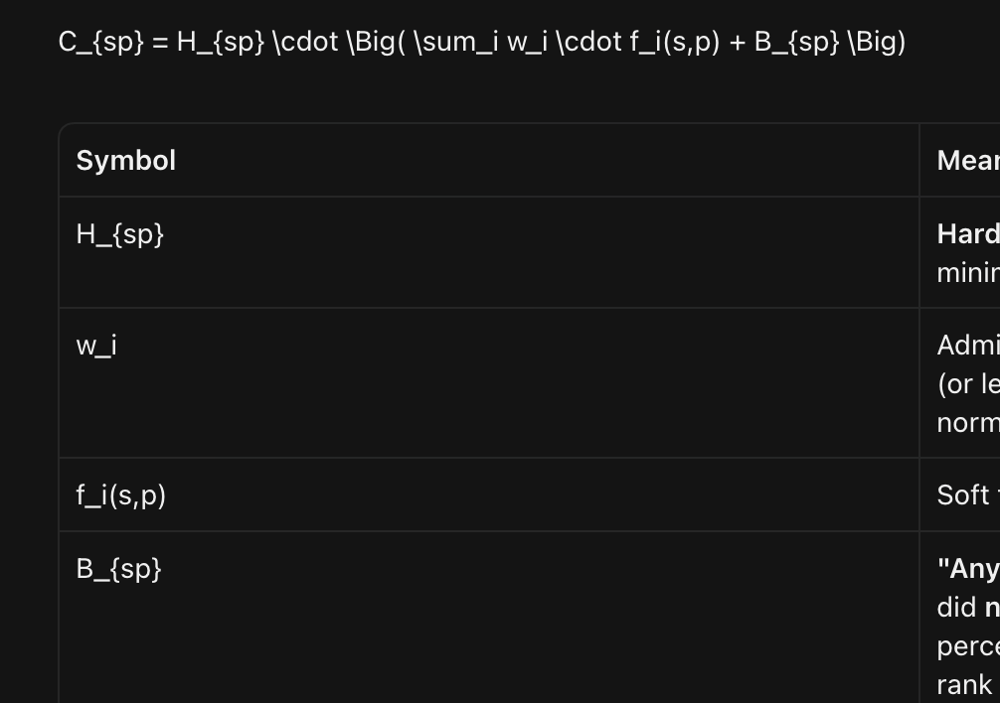

# Internship Matching Platform — Architecture & Weighting Plan

> **Current vs planned.** This document is the original design. The shipped product is a vanilla JS SPA on Firebase (Auth, Firestore, Storage, Hosting), documented in [website.md](website.md). React, FastAPI, PostgreSQL, and Box sync were never generated. The two-stage scoring + ILP math below still describes how matching is *meant* to work; the live browser solver is a custom exact/heuristic search, and the production-quality CBC ILP lives in [`demo/match_demo.py`](../demo/match_demo.py).

**Planned stack (not shipped):** React (Vite + TypeScript) · FastAPI · PostgreSQL · Google OR-Tools (CBC) · Box SDK for finalized report sync

---

## How variable weighting works

Matching is a **two-stage pipeline**: (1) score every student–project pair into a compatibility matrix, (2) solve one ILP over the whole cohort so team composition constraints are satisfied globally.

### Stage 1 — Compatibility score \(C_{sp}\)

For student \(s\) and project \(p\):

\[
C_{sp} = H_{sp} \cdot \Big( \sum_i w_i \cdot f_i(s,p) + B_{sp} \Big)
\]



| Symbol | Meaning |
|--------|---------|
| \(H_{sp}\) | **Hard gate** ∈ {0, 1}. If any hard constraint fails (e.g. GPA below project minimum), \(C_{sp} = 0\) and the pair is infeasible in the ILP. |
| \(w_i\) | Admin slider weight on scale **0–10**, normalized so \(\sum w_i = 1\). |
| \(f_i(s,p)\) | Soft feature score in **[0, 1]** for that dimension. |
| \(B_{sp}\) | **"Any Project Fits" bonus**: if student flagged open-minded and did **not** rank \(p\), add \(\beta \cdot \bar{f}\) where \(\beta\) is a flat percentage (e.g. 0.05–0.15) of baseline soft score; if they *did* rank \(p\), bonus is 0. |

**Default soft features \(f_i\) (all mapped to [0,1]):**

1. **Project preference** — rank → score: 1st = 1.0, 2nd = 0.8, … unranked = 0 (before any-project bonus).
2. **Relevant skills** — Jaccard or weighted coverage of required skills vs student skills.
3. **Topic / major fit** — overlap of majors/topics with project tags.
4. **Shared availability** — fraction of mandatory meeting slots the student can attend (grid ∩ schedule).
5. **Skill distribution (team-aware proxy)** — optional pairwise term used later in ILP as a diversity penalty/bonus; at matrix stage, score individual skill depth vs prerequisites.

**Hard constraints (multiply \(H_{sp}\)):**

- GPA ≥ project minimum
- Student available for **all** mandatory meeting blocks (or fail)
- Prerequisite skills marked `required=true` must be fully covered (or fail — tunable later)
- Explicit teammate avoidance: encoded as ILP constraint, not in \(C_{sp}\)

**Admin sliders (0–10)** map to \(w_i\). Changing sliders rebuilds \(C_{sp}\) and re-solves; drafts are versioned so overrides are not lost until a new solve overwrites unlocked cells.

See also: [pipeline-flow.md](visuals/pipeline-flow.md)

### Stage 2 — ILP (cohort as one unit)

**Decision vars:** \(x_{sp} \in \{0,1\}\) — assign student \(s\) to project \(p\).

**Objective:** maximize \(\sum_{s,p} C_{sp} \cdot x_{sp}\) (optionally minus penalties for skill imbalance).

**Constraints (core):**

- Each student assigned to at most one project (or exactly one if policy requires full placement)
- Each project gets exactly `headcount` students (or between min/max if you add ranges later)
- If \(C_{sp} = 0\), force \(x_{sp} = 0\)
- Avoidance: for students \((s_a, s_b)\) who must not share a team, forbid co-assignment on the same project
- Locked admin overrides: fix \(x_{sp} = 1\) (and free other projects for that student)

Locked cells from TeamBuilder are passed as fixed variables on re-solve so managers can pin people and re-optimize the rest.

---

## Monorepo file structure

```text
dpi-matching-optimizer/
├── README.md
├── docker-compose.yml          # postgres (+ api/web later)
├── .env.example
├── backend/
│   ├── pyproject.toml / requirements.txt
│   ├── app/
│   │   ├── main.py             # FastAPI entry
│   │   ├── config.py
│   │   ├── db.py               # SQLAlchemy async engine
│   │   ├── models/             # ORM tables
│   │   ├── schemas/            # Pydantic DTOs
│   │   ├── api/                # routers: students, projects, matches, admin
│   │   ├── matching/
│   │   │   ├── weights.py      # normalize sliders → w_i
│   │   │   ├── features.py     # f_i(s,p) scorers
│   │   │   ├── compatibility.py  # build C matrix + hard gates
│   │   │   ├── solver.py       # OR-Tools ILP
│   │   │   └── types.py
│   │   └── services/box_sync.py
│   ├── alembic/
│   └── tests/matching/
├── frontend/
│   ├── package.json
│   ├── src/
│   │   ├── App.tsx
│   │   ├── api/
│   │   ├── pages/              # student wizard, startup form, admin
│   │   ├── components/
│   │   │   ├── WeightSliders.tsx
│   │   │   └── TeamBuilderBoard.tsx  # dnd-kit Kanban
│   │   └── types/
└── docs/
    ├── README.md
    ├── architecture-plan.md
    ├── weighting-guide.md
    ├── matching-math.md
    └── visuals/
```

---

## PostgreSQL schema (foundational)

See [schema-er.md](visuals/schema-er.md) for the ER diagram.

**Tables (high level):**

- `cohorts` — season/program instance
- `students` — major(s), GPA, `any_project_fits` bool, contact fields
- `student_skills` — `(student_id, skill_id, level)`
- `availability_slots` — grid cells `(day, start, end)` or slot_id FKs
- `project_rankings` — `(student_id, project_id, rank)`
- `avoidances` — `(student_id, avoided_student_id)`
- `projects` — mission, deliverables, `headcount`, `min_gpa`
- `project_skills` — `(project_id, skill_id, required bool, weight)`
- `meeting_slots` — mandatory schedule blocks
- `skills` — catalog
- `weight_configs` — named slider sets per cohort (`project_pref`, `skills`, `availability`, … → 0–10)
- `match_runs` — status (`draft`/`final`), weight snapshot JSON, solver metadata
- `match_assignments` — `(run_id, student_id, project_id, score, locked bool, source: solver|manual)`

Box sync stores `box_file_id` on finalized `match_runs`.

---

## Matching algorithm boilerplate (first implementation stub)

Under `backend/app/matching/`:

1. **`weights.normalize(sliders: dict[str, float]) -> dict[str, float]`** — 0–10 → sum-to-1.
2. **`features.*`** — pure functions returning [0,1] for preference, skills, availability, topics.
3. **`compatibility.build_matrix(students, projects, weights, beta)`** — apply \(H_{sp}\), soft combo, any-project bonus; return \(C\) and infeasibility mask.
4. **`solver.solve(C, headcounts, avoid_pairs, locks) -> assignments`** — OR-Tools CBC: max \(\sum C_{sp} x_{sp}\) under constraints above.

API surface for Phase 2/3: `POST /cohorts/{id}/match-runs` (build + solve), `PATCH .../assignments` (manual move + lock), `POST .../finalize` (trigger Box sync later).

---

## Implementation phases

1. **Scaffold** monorepo: FastAPI app, React Vite app, docker-compose Postgres, Alembic migrations for schema above.
2. **Matching package** with unit tests on toy cohort (hard GPA gate, preference ranks, any-project bonus, avoidance, headcount).
3. **Thin CRUD APIs** for students/projects/weights sufficient to feed the solver.
4. **Admin UI stubs:** weight sliders + TeamBuilder board wired to draft assignments (forms/Box can follow).

First engineering deliverable: scaffolding + schema + working solver boilerplate with tests — not the full wizards or Box integration yet.

---

## Related docs

- [Weighting guide (colleague presentation)](weighting-guide.md)
- [Matching math reference](matching-math.md)
- [Docs index](README.md)
