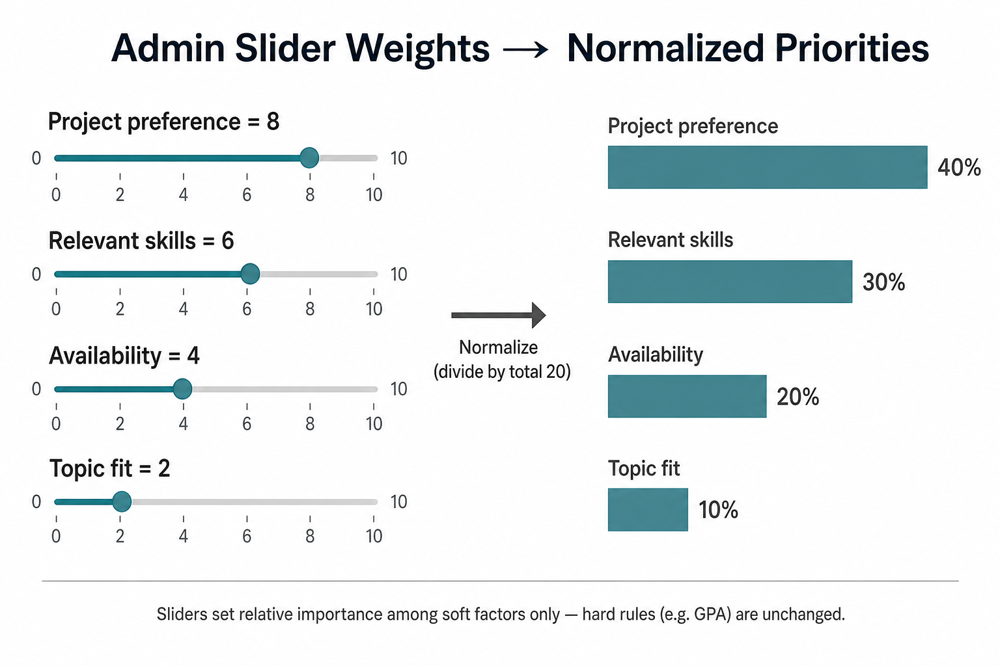

# How the Weighing Scale Works

Colleague-ready explanation of admin priorities, soft scores, and hard rules.

---

## What the weighing scale is for

Program managers set **priorities for the whole cohort** with sliders (0–10). Those priorities decide how much each soft factor counts when scoring “how good is student S for project P?”

The algorithm never matches one student at a time in isolation. It first scores **every** student–project pair, then solves one global optimization so team sizes and constraints work for the **whole** cohort.

---

## The score in one sentence

> For each student–project pair: if they fail any **must-pass** rule, score = 0. Otherwise, take a weighted mix of soft fit scores, add an open-mindedness bonus when relevant, and use that number in the optimizer.

---

## Two kinds of rules

### 1. Hard constraints (pass / fail)

These are **not** on the 0–10 sliders. They are binary:

- GPA below the project minimum → **disqualified**
- Can’t attend mandatory meetings → **disqualified**
- Missing a required prerequisite skill (if treated as hard) → **disqualified**

Think of this as a gate: **0 or 1**. If hard fails, soft scores and weights don’t matter for that pair.

### 2. Soft constraints (scored, then weighted)

These *are* what the sliders control. Each soft factor is first scored on a **0 to 1** scale (0 = poor fit, 1 = excellent fit):

| Soft factor | What “1.0” roughly means |
|-------------|---------------------------|
| Project preference | Student ranked this project #1 |
| Relevant skills | Student covers the project’s skills well |
| Topic / major fit | Majors/topics align with the project |
| Shared availability | Student is free for the project’s meeting grid |

Then managers dial importance with **0–10 sliders**.

---

## How the 0–10 sliders work



Example slider set:

| Priority | Slider |
|----------|--------|
| Project preference | 8 |
| Relevant skills | 6 |
| Availability | 4 |
| Topic fit | 2 |

**Step 1 — Normalize** so weights sum to 1:

- Total = 8 + 6 + 4 + 2 = 20
- Preference weight = 8/20 = **40%**
- Skills = 6/20 = **30%**
- Availability = 4/20 = **20%**
- Topics = 2/20 = **10%**

Text version (always readable):

```text
Sliders (0–10)          →    Normalized share
─────────────────────        ─────────────────
Preference     ████████  8   ████████████  40%
Skills         ██████    6   █████████     30%
Availability   ████      4   ██████        20%
Topic fit      ██        2   ███           10%
                 total 20         sum     100%
```

So “8 vs 6” means preference matters more than skills, not “8 points of GPA.”

**Step 2 — Combine** for one pair:

> Soft score = (0.40 × preference) + (0.30 × skills) + (0.20 × availability) + (0.10 × topics)

If a student has preference 1.0, skills 0.5, availability 0.8, topics 0.3:

> Soft score = 0.40×1.0 + 0.30×0.5 + 0.20×0.8 + 0.10×0.3 = **0.71**

**Changing sliders only changes relative importance.** It does not change hard rules (GPA still fails or passes the same way).

---

## The “Any Project Fits” bonus

Separate from sliders:

- Student turns on **“I’m open to projects I didn’t rank.”**
- For projects they **didn’t** select, we add a **flat percentage boost** to their soft score (e.g. +5% or +10% of baseline).
- For projects they **did** rank, no bonus (their ranking already counts via the preference factor).

Purpose: slightly favor flexible students for unfilled / less popular projects without ignoring people who stated clear preferences.

---

## Full picture

```text
1. Hard gate
   Fail → score = 0 (cannot assign)
   Pass → continue

2. Soft features (each 0–1)
   preference, skills, availability, topics, …

3. Apply manager weights (0–10 → % shares)
   weighted average of soft features

4. Add “Any Project Fits” bonus if applicable

5. Final compatibility C(student, project)

6. ILP optimizer
   Maximize total compatibility across the cohort
   while respecting headcounts, one-project-per-student,
   teammate avoidances, and any admin locks
```

Diagrams: [pipeline-flow.md](visuals/pipeline-flow.md) · [pair-scoring.md](visuals/pair-scoring.md)

---

## Takeaways for stakeholders

1. **Sliders = priorities among soft goals**, not pass/fail rules.
2. **Hard rules always win** (especially GPA).
3. Scores are **relative fit (0–1)**, then mixed by weights.
4. The optimizer uses the full matrix so **teams and capacity** are correct, not just “best single match.”
5. Output is a **draft**; managers can override in TeamBuilder and lock assignments.

## Analogy

Hard constraints = **eligibility checklist**.  
Soft scores = **how good the fit is**.  
Sliders = **how much you care about each kind of fit this semester**.  
ILP = **seat everyone into teams of the right size** so the whole cohort’s total fit is as high as possible.
